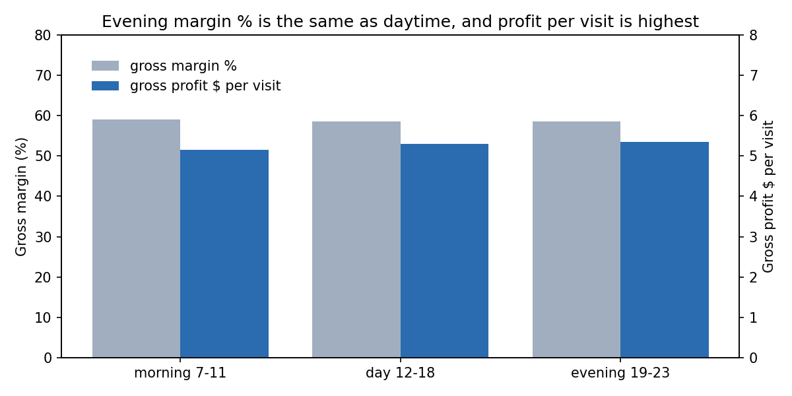
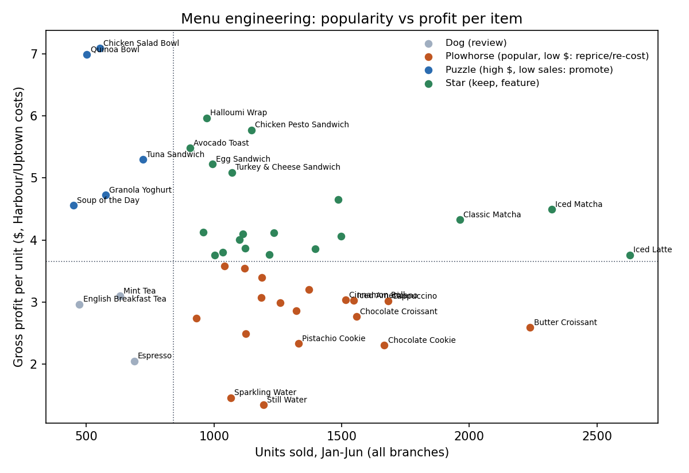
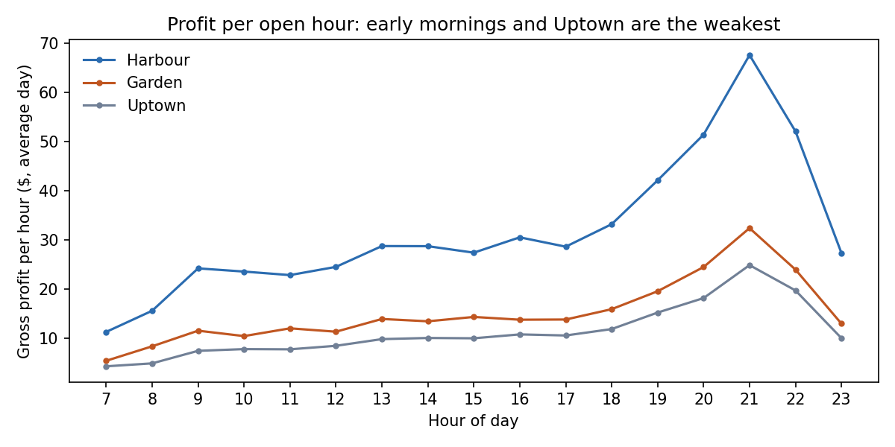

# Appendix: secondary findings

These findings support the main report ([README.md](README.md)) but are not needed for its recommendation. None of them depend on Customer IDs.
All values are reproducible from the scripts named.

## A1. Rejected: "evenings hurt profit because of desserts" (`06_original_findings.py`)
Desserts rise from 8.4% to 12.1% of revenue after 19:00 and have the lowest margin (47.7%). But evening margin is **58.6% vs 58.5% in the day**, and
**GP per visit is highest in the evening ($5.34 vs $5.31 day, $5.16 morning)**, because Cold Coffee and Matcha (61–66% margin) rise too. There is no
evening margin problem.

## A2. Attach rate: 28% everywhere; a suggestion beats a discount (`10_basket_and_menu.py`)
Visits are 41% drink-only ($4.48 GP), 31% food-only ($4.40) and 28% drink + food ($7.46). The attach rate is 28% at every branch, daypart and order type,
so there is no internal benchmark showing a higher rate is achievable. If 3–5% of single-category visits added the other category, that would be
**+$4.8–8.1k/yr** (estimate). A $0.50 combo discount would give away ~$9.6k/yr on combos that already happen, so use a barista prompt instead (most common
pairs: Matcha + Bakery, Hot Coffee + Bakery; raw counts mostly reflect popularity). For pairings that beat chance and replicate on unseen months, see
README 8.6. The conversion rate is assumed, not measured. Test at one branch for a month.

## A3. Menu engineering (`10_basket_and_menu.py`, `results/menu_engineering.csv`)
Classifying products by popularity and GP per unit (at Harbour/Uptown costs, so Garden's distortion doesn't drive it):
- **19 Stars** (47% of units): iced and matcha drinks, sandwiches.
- **18 Plowhorses** (45% of units): bakery, basic coffee, water; popular but under $3.66 GP/unit.
- **5 Puzzles**: Chicken Salad Bowl, Quinoa Bowl, Tuna Sandwich, Granola Yoghurt, Soup; $4.6–7.1 GP/unit but rarely bought. Feature them.
- **3 Dogs**: Espresso, Mint Tea, English Breakfast Tea; 3% of units. Review them; don't remove them automatically.

**Are the Dogs dead weight? (`18_menu_anchor_check.py`)** 65–70% of their baskets include other items. Baskets with Mint Tea or English Breakfast Tea earn
**more than the average basket** ($5.80 and $5.60 vs $5.29 GP), and Mint Tea + Chocolate Cookie is one of the validated pairs (README 8.6). Espresso
baskets earn less ($4.58). Whole baskets containing each item are worth $5.0–6.9k/yr. That is the upper bound at risk if removing the item lost those
baskets; the loss is ~$0 if buyers simply switch items. The data can't tell which, so: keep the teas, and if anything is tested, try removing Espresso
at one branch first.

## A4. Gross profit per open hour (`12_costs_and_hours.py`, `results/gp_per_branch_hour.csv`)
On an average day, GP per hour ranges from $4.4 (Uptown 7:00) and $5.5 (Garden 7:00) up to $67.5 (Harbour 21:00). The weakest cells are Garden Saturday 7:00
($3.1/hour) and Uptown Saturday 7:00–9:00 ($3.2–4.6/hour). **Rule:** keep an hour open only if its extra staff and energy cost is below the
**avoidable contribution** it earns. Recorded GP is a starting point; applying the rule needs Stories' own labour and energy costs. If some early customers would come later instead (unmeasured; it could be zero), closing loses less than these figures. Fixed
opening duties may make the first hour's staff cost unavoidable. Recorded GP also isn't cash: at Garden, if the 1.43 cost uplift is an allocation, the cash
lost by closing an hour would be higher than its recorded GP. Treat this as a candidate for a one-branch trial, not a decision.

## A5. Uptown pricing scenarios (`08_uptown_pricing.py`)
Uptown prices equal Garden's prices × 0.96 (≈ Harbour × 0.914), while its costs are Harbour × 0.96.

| Assumed elasticity | 0 | −0.5 | −1.0 | −1.5 | −2.0 |
|---|---|---|---|---|---|
| Uptown +4.2% (to Garden level), $/yr | +$4,686 | +$3,116 | +$1,545 | −$26 | −$1,597 |
| Uptown +9.4% (to Harbour level), $/yr | +$10,519 | +$6,720 | +$2,921 | −$878 | −$4,678 |

The break-even volume loss is 6.3% for +4.2% and 13.0% for +9.4%. Uptown may be priced low on purpose (location), so run it only after the Garden pilot.

## A6. Procurement benchmark (`12_costs_and_hours.py`)
Uptown has the lowest recorded unit cost on all 45 items (= Harbour × 0.96). Buying at Uptown's cost everywhere would be worth $39.1k/yr in total,
**$7.2k/yr beyond the Garden-only fix** (Harbour $4.2k, Garden $3.0k). Why Uptown's recorded costs are lower is unknown: sales volume says nothing about
purchasing terms or pooled contracts. Include Uptown's invoices in the audit.

## A7. Garden pilot item list, if Stories prefers a partial pilot (`05_garden_products.py`)
These 8 items have enough volume and the most $ at stake: Iced Matcha, Strawberry Matcha, Cheesecake, Classic Matcha, Brownie, Frozen Yoghurt,
Iced Latte and Tiramisu. Together they sell 26 units/day at Garden and are worth $1.5k/yr at elasticity −1. Measured on those items' units, a partial
pilot needs **two** months as a daily-noise planning estimate: it detects 10.2% in one month and 7.1% in two (these would be at least as large with
month-level error, which hasn't been validated for these eight items). A
whole-menu pilot, measured as in README section 5, is cleaner.

## A8. Stock-out screen: inconclusive, because the screen has low power (`17_stockout_screen.py`)
For every product, branch and day we compared actual units with what the product normally sells given that day's branch traffic (so weekday, growth
and branch effects are built in), under a Poisson model. Zero-sales days: **5,205 observed vs 4,884 expected by chance** (overall variation 1.09× pure
chance). For products expected to sell 4+ units that day: 20 zero days vs 19.6 expected. Units include 2-unit lines, so this model under-predicts zero
days; the small excess may be a modelling artefact rather than a shortage signal. **Extreme low-sales days: 0 observed**, but only 336 of 24,435
product-branch-days have enough expected demand for even zero sales to be flagged, and chance would produce only ~0.17 flags. So observing none says little.
**Conclusion:** this daily screen gives no evidence for an inventory investment, but it also has limited ability to detect shortages, especially for
slow-selling products. Availability remains unresolved without stock records or hourly availability data.

## A9. Peak load in 15-minute slots: staffing to hourly averages understates the rush (`19_peak_load.py`)
In June, the busiest 15 minutes held **12 orders at Harbour, 8 at Garden and 7 at Uptown**, about **1.9–2.2×** what the busiest hour would give if it
were spread evenly (6.5, 4.0 and 3.3 per 15 minutes). On a typical June Tuesday, each branch's busiest 15 minutes hold about 8.2 orders at Harbour, 6.6
at Garden and 4.6 at Uptown. If +8.5%/month growth continued (not established), these would reach ~13.4, ~10.8 and ~7.5 by December (estimate). Part of
any peak is normal randomness, but that is exactly what a counter has to absorb. **Action:** compare these 15-minute peaks with how many orders one
barista and one till can serve in 15 minutes (not in the data). That comparison, not the hourly average, shows when queues and lost sales begin.
