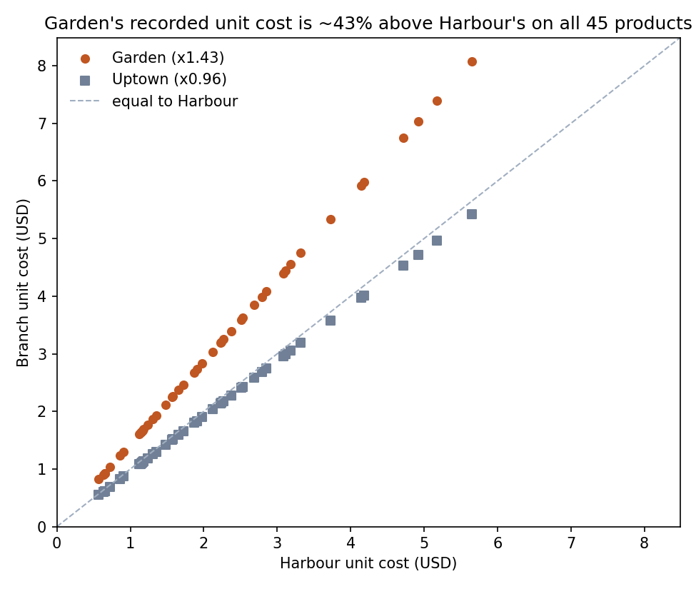
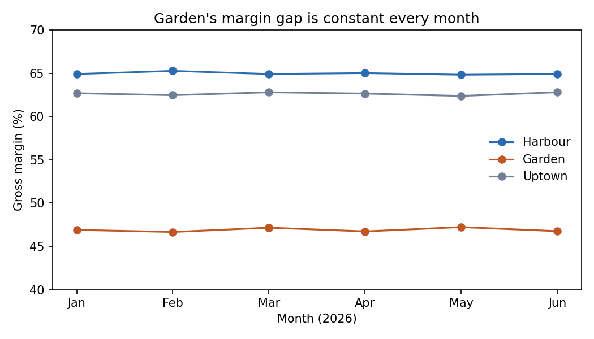
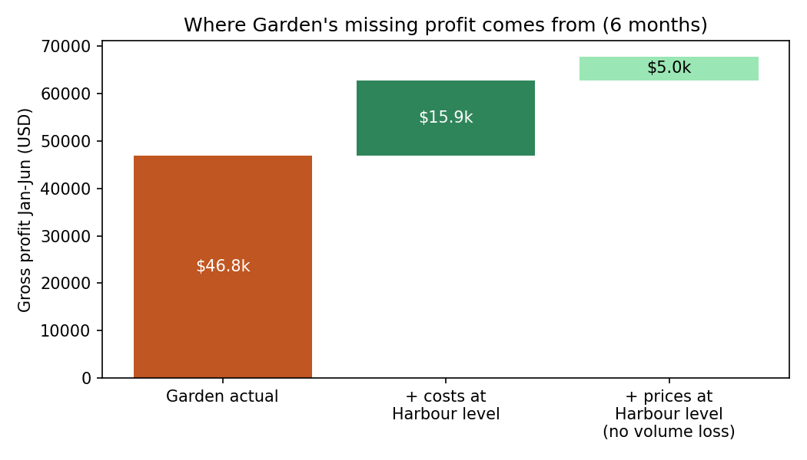
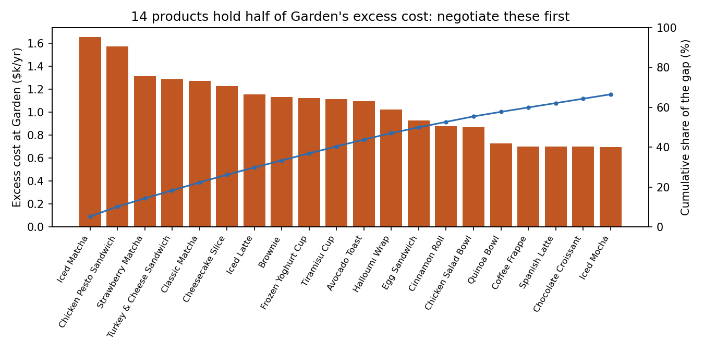
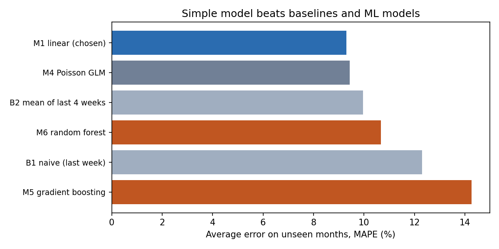
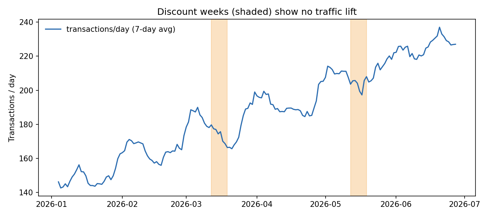
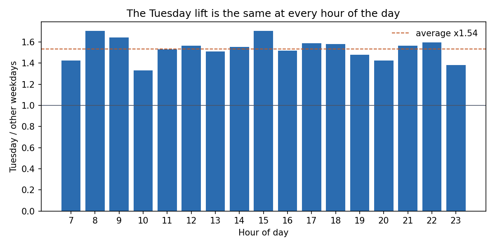
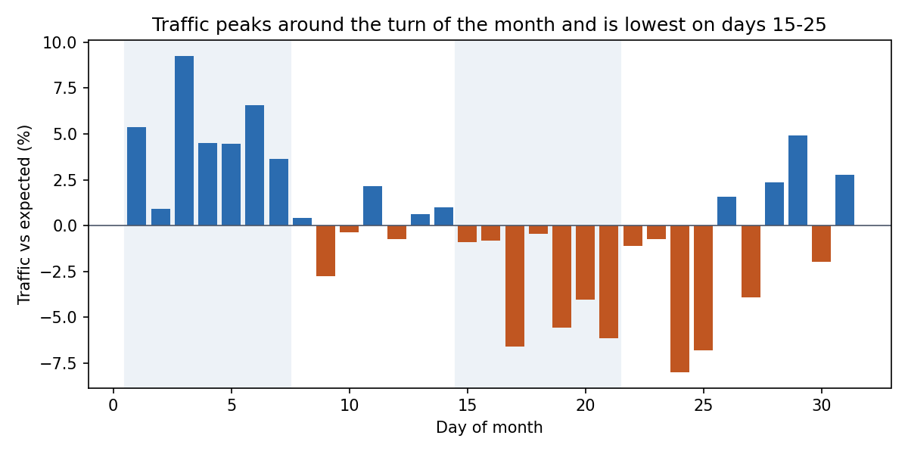
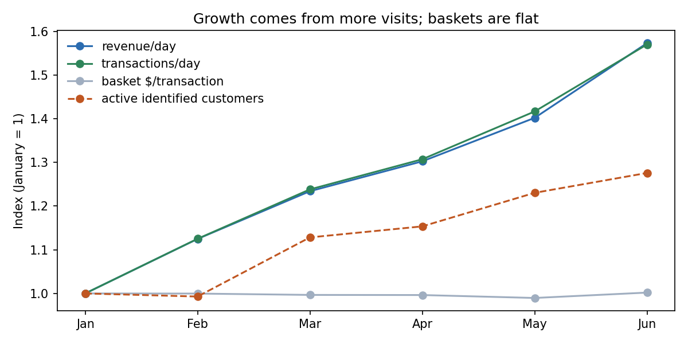

# Stories Coffee: Garden's recorded costs are 43% above Harbour's on every item, while its prices are ~4.8% lower

**EECE490 Stories Coffee Hackathon, AUB**
**Team:** Abdallah Makke, Racha Massoud, Christia Daoud

> One-screen version: [SUMMARY.md](SUMMARY.md) · Secondary findings: [APPENDIX.md](APPENDIX.md) · Every number below is printed by a
> script in `analysis/` into `results/` (see the evidence index).

---

## Conclusion for the CEO

Garden earns **46.9% gross margin vs Harbour's 65.0%** on the same menu. For **all 45 items**, Garden's *recorded* unit cost equals
**Harbour's × 1.43** and its price equals **Harbour's ÷ 1.05** (~4.8% lower), exactly after rounding to cents. The observed differences in product mix, discounts, basket and timing don't explain the gap.
**If the 1.43 is a real purchase premium, it costs $31.8k of gross profit a year; if it is an accounting allocation, it costs $0 in cash.**
**(1)** Audit Garden's cost sheet against invoices this month. It costs ~$400 of staff time and breaks even in year one at a ~3.3% chance the premium is real.
**(2)** Test +5% prices at Garden for **one full calendar month** against a frozen traffic forecast, and **keep the rise only if the measured loss is
clearly below break-even** (below 6.1%, or 3.9% once costs are fixed). Historically the frozen forecast missed monthly traffic by ~2%; that is forecast
accuracy, not proof of what a price change causes, so the pilot also cross-checks against the other branches.
Together: **$20–42k/yr if the premium is real, $3–10k if not.** Warning: Customer IDs show no detectable customer behaviour (8.1), so validate
them before any loyalty or CRM decision.

## Money on the table (annual gross profit; estimates unless marked)

| # | Action | If the 1.43× is a real purchase premium | If it is an accounting allocation | Confirm first by |
|---|---|---|---|---|
| 1 | **Audit, then fix Garden's cost uplift** | **+$15.9k (50% closed) to +$31.8k (100%)**; $38.7k at the June run-rate | $0 cash; corrected branch P&L | Invoice audit (section 6) |
| 2 | **+5% Garden prices** (to Harbour level) | +$3.2k to +$10.0k (elasticity −1 to 0; the lower end applies after a full cost fix) | +$3.2k to +$10.0k (avoidable cost assumed ≈ Harbour's; the allocated part doesn't vary with volume) | 1-month pilot with a one-sided keep rule (sections 5–6) |
| | **Combined** (not the sum of the two ranges: 50% recovery + elasticity −1 → $20k; 100% recovery + elasticity 0 → $42k) | **≈ $20–42k/yr (≈ 6–12% more gross profit)** | **≈ $3–10k/yr** | |
| 3 | *Lower confidence:* buy at Uptown's unit costs everywhere (cheapest on all 45 items, = Harbour × 0.96) | +$7.2k beyond the Garden fix | unknown | Add Uptown to the audit |
| 4 | *Lower confidence:* the always-on 10% discount (no observed targeting) | up to +$3.1k, **but a loss if more than 0.9% of visits depend on it** (not measurable) | same | Check its eligibility rules first; then test retargeting it |

These are annual run-rates once implemented; year one is lower by the months spent on the audit and the pilot. **One-off implementation costs** (audit,
menu/POS changes, monitoring, supplier switching) are not in the data. After an *assumed* $3,000 of one-off costs, a full 12 months of post-implementation
benefits would net $16.9k–38.8k if the premium is real, or +$0.2k at elasticity −1 under allocation (`results/14_rules_value_pilot.txt` §6). The
implementation year itself is lower because of delays, and can be negative in the allocation case.
The stress test in section 7 shows which assumptions could flip each action.

**Expected first-year net benefit of the audit** = P(real premium) × savings recovered − audit cost (`results/14_rules_value_pilot.txt`; 50% recovery,
savings starting after a 3-month implementation delay, switching/contract costs not included): **−$400 at 0%**, −$101 at 2.5% (break-even 3.3%), **+$2.6k at 25%**, +$5.6k at 50%.
A real premium may also prove impossible to remove (contracts, logistics, quality), which is what the 50% recovery case stands for. The value of corrected reporting is real but not monetised here.

### Evidence index: where to check each headline claim

| Claim | Type | Script → output |
|---|---|---|
| Margins 46.9% / 65.0% / 62.6%; Garden cost ×1.426–1.439, price ×0.952 | Observed | [`02_garden_margin.py`](analysis/02_garden_margin.py) → [`results/02_garden_margin.txt`](results/02_garden_margin.txt) |
| Exact rules: Garden cost = round(H×1.43), Garden price = round(H/1.05), Uptown cost = round(H×0.96), Uptown price = round(Garden price×0.96), 45/45 items each | Observed | [`14_rules_value_pilot.py`](analysis/14_rules_value_pilot.py) → [`results/14_rules_value_pilot.txt`](results/14_rules_value_pilot.txt) |
| Observed differences in product mix, discounts, basket and timing don't explain the gap | Observed | [`02_garden_margin.py`](analysis/02_garden_margin.py) → [`results/alternative_explanations.csv`](results/alternative_explanations.csv) |
| Cost gap $31.8k/yr (H1 × 2; the robustness file's $32.1k uses per-day × 365); robust to data choices; 14 products hold half | Estimate | `02`, `05`, `07` → [`results/07_robustness.txt`](results/07_robustness.txt), [`results/garden_products.csv`](results/garden_products.csv) |
| Promo price cut 7.8%: no detectable change in the promoted categories' share vs the same days of other months (weak supporting evidence only) | Observed | [`14_rules_value_pilot.py`](analysis/14_rules_value_pilot.py) |
| Always-on discount: $1,558 in H1 (observed), ≈ $3.1k/yr (estimate), spread evenly across every segment | Observed / estimate | [`14_rules_value_pilot.py`](analysis/14_rules_value_pilot.py) |
| Forecast beats 2 baselines and 2 ML models on 4 unseen months; 95% intervals cover 99% | Observed (test data) | [`11_model_comparison.py`](analysis/11_model_comparison.py) → [`results/11_model_comparison.txt`](results/11_model_comparison.txt) |
| A 1-month pilot detects ~5.9% on Garden traffic vs forecast; company GP is not detectable | Estimate | [`15_pilot_decision_rule.py`](analysis/15_pilot_decision_rule.py), [`11_model_comparison.py`](analysis/11_model_comparison.py) |
| Frozen-forecast monthly error ~2% (fixed-origin backtest); keep thresholds 6.1% / 3.9%; keep probabilities by true loss and forecast bias | Estimate (normal approximation, few windows) | [`15_pilot_decision_rule.py`](analysis/15_pilot_decision_rule.py) → [`results/15_pilot_decision_rule.txt`](results/15_pilot_decision_rule.txt) |
| Customer IDs inside the 95% range of 100 random shuffles on 6 of 6 tests (plus an illustrative sensitivity check) | Observed | [`13_customer_id_validity.py`](analysis/13_customer_id_validity.py) → [`results/13_customer_id_validity.txt`](results/13_customer_id_validity.txt) |
| 14 product pairs bought together beyond chance, validated on unseen Apr–Jun (matcha + bakery; savoury food + water) | Observed | [`16_basket_affinity.py`](analysis/16_basket_affinity.py) → [`results/16_basket_affinity.txt`](results/16_basket_affinity.txt) |
| Tuesday +53%, Saturday −30%, turn-of-month +6.8%, growth +8.5%/month | Observed | [`06_original_findings.py`](analysis/06_original_findings.py) → [`results/06_original_findings.txt`](results/06_original_findings.txt) |

---

## Contents
1. [The problem and why we chose it](#1-the-problem-and-why-we-chose-it)
2. [Evidence: what we observed](#2-evidence-what-we-observed)
3. [Alternative explanations we tested](#3-alternative-explanations-we-tested)
4. [Business value](#4-business-value)
5. [Model: measuring the price pilot](#5-model-measuring-the-price-pilot)
6. [Decisions compared, actions and tests](#6-decisions-compared-actions-and-tests)
7. [Assumptions and what would change our recommendation](#7-assumptions-and-what-would-change-our-recommendation)
8. [Other original findings](#8-other-original-findings)
9. [Data quality](#9-data-quality)
10. [Approaches and conclusions we rejected or withdrew](#10-approaches-and-conclusions-we-rejected-or-withdrew)
11. [Limitations and missing information](#11-limitations-and-missing-information)
12. [Reproduce](#12-reproduce)

---

## 1. The problem and why we chose it

**Problem:** Garden is Stories' second-largest branch ($99.7k revenue, 33% of sales) but earns 18 margin points less than Harbour. Why, and
what should Stories do? We screened discount weeks, weekly and monthly traffic cycles, growth and capacity, customer behaviour, evening margins,
basket attach rates and opening hours. We chose this problem because it has **the largest dollar value, the strongest evidence and a clear owner
(finance and procurement)**. The other analyses are in section 8 and [APPENDIX.md](APPENDIX.md); several support the main recommendation.

## 2. Evidence: what we observed

Source: `results/02_garden_margin.txt`, `results/14_rules_value_pilot.txt`. All **observed**, Jan 1 – Jun 30, 2026.

| Branch | Revenue | Gross profit | COGS | Gross margin |
|---|---|---|---|---|
| Harbour | $150,484 | $97,754 | $52,730 | **65.0%** |
| Uptown | $55,693 | $34,882 | $20,811 | **62.6%** |
| Garden | $99,749 | $46,794 | $52,954 | **46.9%** |

**Four exact branch rules (exact after rounding to the cent):**

| Rule | Products matching |
|---|---|
| Garden unit cost = round(Harbour cost × **1.43**, 2) | **45 of 45** |
| Uptown unit cost = round(Harbour cost × **0.96**, 2) | **45 of 45** |
| Garden price = round(Harbour price ÷ **1.05**, 2) | **45 of 45** |
| Uptown price = round(**Garden** price × **0.96**, 2) | **45 of 45** (vs Harbour × 0.915: only 36 of 45 within 1 cent) |

**The price lists form a chain:** Harbour → ÷ 1.05 → Garden → × 0.96 → Uptown. Uptown's prices are derived from **Garden's**, not Harbour's, so Garden's
~4.8% discount carries over automatically to Uptown. One audit question ("why is Garden priced at Harbour ÷ 1.05?") therefore covers two branches' pricing.



- Unit costs and prices **never change** within a (product, branch) over 6 months (observed). *Inference:* they are set by central rules, not
  measured from actual purchases.
- **The contradiction:** Garden's prices were set *below* Harbour's while its recorded costs were set 43% *above*. To earn Harbour's margin at today's
  costs, Garden would need prices ~43% above Harbour's, which looks commercially risky. So investigate the cost difference first.
- Every product earns less at Garden. 6 items fall below 35% margin (Sparkling Water 29%, Turkey & Cheese 30%, Chicken Pesto 31%, Brownie 34%,
  Cheesecake 34%, Chicken Salad Bowl 35%); at Harbour, none is below 53%.



## 3. Alternative explanations we tested

| Explanation | Verdict | Evidence |
|---|---|---|
| Garden sells a lower-margin product mix | **Rejected** | On the identical company-wide mix: Garden 47.4% vs Harbour 65.0% |
| Garden discounts more | **Rejected** | Garden discounts *less* (0.55% of list revenue vs 0.86%) |
| Measured differences in customer behaviour (basket size, order type, time of day) | **Rejected** | Items/txn 1.60 vs 1.60; takeaway 41.5% vs 40.9%; evening share 44.1% vs 44.0%. Unmeasured differences (e.g. willingness to pay) can't be tested here. |
| Recent supplier price rise / inflation | **Not testable from this export** | Recorded costs are flat Jan–Jun, but a cost sheet that is never updated would also be flat. Invoices would show it. |
| Packaging or labour loaded into COGS | **Not distinguishable from a fixed allocation** | A standard-cost uplift can include packaging or labour without varying by order type or weekday. Recipe, packaging and payroll records would show it. |
| Data-cleaning artefact | **Rejected** | Dropping duplicates or promo weeks moves the gap by < 1% |
| Waste, spoilage, theft, over-portioning | **Can't be tested here** | Costs are fixed standard costs, so real waste would not show in this data. The uniform 1.43 is a rule, not waste. |
| **Supplier contract / delivery premium** | **Consistent** | A single multiplier on all inputs fits a contract or logistics surcharge |
| **Rent/overhead booked into Garden's COGS** | **Consistent** | Same pattern; would mean **no cash saving** (A1) |
| **Wrong multiplier in the cost sheet** | **Consistent** | Would look exactly like this |

Only Stories' finance team can tell the last three apart, by comparing invoices. **That is why action 1 is an audit, not a supplier switch.**

## 4. Business value

All values here are **estimates**. Sources: `results/02_garden_margin.txt`, `05_garden_products.txt`, `07_robustness.txt`, `14_rules_value_pilot.txt`.



| Garden's missing gross profit | 6 months | Per year (H1 × 2) | Per year (June run-rate) |
|---|---|---|---|
| Cost effect (costs at Harbour level) | $15,923 | **$31,847** | $38,686 |
| Price effect (Harbour prices, no volume loss) | $4,986 | $9,972 | $12,077 |

- **Robustness:** without duplicates −0.2%, without promo weeks −0.6%, Jan–Mar only −11%, Apr–Jun only +11%. The gap moves only with volume, never
  with data choices. (A day-level bootstrap gives ±5%, but that is sampling noise only; the real uncertainty is A1.)
- **Partial closure:** 25% → $8.0k, 50% → $15.9k, 75% → $23.9k, 100% → $31.8k per year.
- **Where to negotiate first:** 14 of 45 products hold 50% of the excess cost. The top five are Iced Matcha ($1.65k/yr), Chicken Pesto Sandwich ($1.57k),
  Strawberry Matcha ($1.32k), Turkey & Cheese ($1.29k) and Classic Matcha ($1.27k). 

**The +5% price rise and how price-sensitive customers are.** Prices never change within a branch, so elasticity cannot be estimated directly.

| Assumed elasticity | 0 | −0.5 | −1.0 | −1.5 | −2.0 |
|---|---|---|---|---|---|
| Garden +5%, $/yr | +$9,972 | +$7,385 | +$4,797 | +$2,210 | −$377 |
| Garden +5% after cost fix | +$9,972 | +$6,588 | +$3,205 | −$179 | −$3,562 |

Break-even volume loss: 9.6% (7.4% after the cost fix). Desserts have the most room (13%) and high-margin drinks the least (8%).

**Weak supporting evidence from the promo weeks.** In the two promo weeks, Cold Coffee and Desserts were **7.8% below list price** (observed). Their *share*
of units, relative to other categories, under different controls (`results/14_rules_value_pilot.txt`):

| Comparison | Change in category share | 95% CI |
|---|---|---|
| Weekday + trend (our first result) | −2.6% | −6.8% to +1.8% |
| + month phase | −1.4% | −6.3% to +3.6% |
| Placebo: days 12–19 in non-promo months | −5.1% | −9.5% to −0.6% |
| **Difference-in-differences: promo weeks vs the same days of other months (preferred)** | **+1.7%** | **−4.1% to +7.7%** |

**Challenged twice.** (1) The promo weeks sit in the mid-month dip, and these two categories dip *more* than average mid-month (placebo row), so our
first reading was confounded. (2) More fundamentally, this measures a change in **category share**, not demand: other categories can move too, the
7.8% is the cut vs list price, and who got the discount, and whether it was advertised, are unknown. **So it is not an elasticity estimate, and we no longer
use it to justify the price rise.** It only says a modest price change did not visibly shift purchases. The decision rests on the pilot (section 5).

## 5. Model: measuring the price pilot

**Why a model:** to judge a Garden price rise, Stories needs to know what Garden's traffic *would have been* without it.

**Comparison on unseen data** (backtest over Mar–Jun; fitted models use only earlier months, while the B1/B2 baselines roll forward week by week, see
below; `results/11_model_comparison.txt`):

| Model (average MAPE, Mar–Jun) | Garden txns/day | Company GP/day |
|---|---|---|
| **M1 log-linear: weekday + trend (chosen)** | **9.3%** | **6.9%** |
| M4 Poisson GLM: weekday + trend | 9.4% | 6.9% |
| B2 strong baseline: mean of last 4 same weekdays | 10.0% | 8.1% |
| M6 random forest (weekday, day index, day-of-month, promo) | 10.7% | 9.6% |
| B1 naive baseline: same weekday last week | 12.3% | 10.3% |
| M5 gradient boosting (same features) | 14.3% | 13.1% |

- M1 beats the strong baseline in 4 of 4 months, but only by ~7% (narrowly in March and June); against the naive baseline the margin is 25%.
- **Information sets differ:** B1 and B2 are *rolling* (they use the latest actual weeks, including earlier days of the test month), while M1 is frozen at the
  start of the month. That favours the baselines, so M1's win is conservative. In the pilot, only the frozen M1 is valid, because rolling baselines would
  absorb the price effect. These four months were also used to choose the model, so they are not an untouched final test.
- **Tree models lose for a structural reason:** every test month has more traffic than any training month (+8.5%/month), and trees can't extrapolate.
- **Uncertainty:** M1's 95% intervals contain 99% of unseen days overall. The 80% intervals contain 86% overall but only **77% in June**, so they are
  slightly overconfident in that month.
- **Month-level error:** M1's error on *monthly totals* ranges −1.7% to +1.9%. The pilot backtest below measures this directly.



**Which pilot metric?** All three are compared in the same units as break-even (Garden traffic change; `results/14_rules_value_pilot.txt`,
`results/15_pilot_decision_rule.txt`):

| Metric (no customer IDs needed) | Precision | Role |
|---|---|---|
| **Garden total transactions vs frozen M1 forecast** | monthly error ~2.1% → detects ~5.9% in 1 month (80% power) | **Primary** |
| Garden ÷ (Harbour + Uptown) transactions | monthly error ~3.1% (same fixed-origin method), ~1.5× the primary, but cancels company-wide shocks | Cross-check |
| Garden's share of company traffic | a share moves only ~⅔ as much as Garden's traffic, so it is less sensitive in traffic terms | Not used |

**A detectable drop is not enough to decide. How often would the pilot make the wrong call?** (`results/15_pilot_decision_rule.txt`.)

*Step 1: measure the pilot's real error.* We backtested exactly what the pilot measures: total Garden transactions over the window vs a forecast **frozen at
the window start**, from every possible origin. Errors: 1 month −1.4%, −1.5%, +1.9%, −1.7%; 2 months −3.3%, −0.7%, +0.7%. A 2-month window is **not**
more precise, because a frozen trend drifts. We use a measurement error of **2.1%** (1 month): the larger of the backtest RMS and the pure daily-noise floor.

*Step 2: keep probabilities.* Normal approximation, zero forecast bias, **one calendar month**. Keep rule: measured loss below break-even − 1.645 × 2.1%.

| True Garden volume loss | 0% | 2% | 5% | 12% (harmful) |
|---|---|---|---|---|
| **Real premium not yet recovered** (break-even 9.6%; keep if loss < **6.1%**) | 99.8% | 97.4% | 70.0% | 0.3% |
| **Cost fixed, or 1.43 is an allocation** (break-even 7.4%; keep if loss < **3.9%**) | 96.8% | 81.7% | 30.4% | 0.0% |

- At the zero-profit boundary this rule keeps the rise 5% of the time and a naive "estimate < break-even" rule 50%. **That is by construction, not a validated
  error rate.**
- **Bias sensitivity:** if the forecast is 2% too high or too low, a harmless rise is kept 82–100% of the time and a harmful 12%-loss rise at most 3.3%.
- **Trade-off:** after a cost fix (or under allocation) the rule often **rejects profitable rises** (a 5% loss is kept only 30% of the time). Stories gives up some upside
  in exchange for rarely locking in a loss.
- **Limits:** four 1-month and three overlapping 2-month windows; tail risks can't be validated. Only fixed-horizon keep probabilities are computed. Early stopping
  and extensions are not evaluated, so the protocol uses no open-ended extensions.

**Company profit is measurable, but too imprecisely to attribute this change:** the expected effect (1.1–2.4% of company GP per day) is below what a month can
detect (≥ 4.1%). We judge the pilot on Garden's traffic vs the frozen M1 forecast and compute the company effect from it, assuming baskets stay stable (guardrail).

| How the pilot could fail | Effect | Safeguard |
|---|---|---|
| Company-wide slowdown or holiday | Raw Garden traffic drops for reasons unrelated to price | Cross-check against Garden ÷ (Harbour + Uptown) |
| Turn-of-month and weekday cycles (~6%) | Partial months are biased | Full calendar months (or explicit calendar controls); weekday in the model |
| Basket size or mix changes with the price | Traffic understates or overstates the profit effect | Track units/transaction and category mix as guardrails |
| Visits move to other Stories branches | Garden's drop overstates the company loss | Conservative; also check Harbour/Uptown vs their own forecasts |
| Model refit on pilot data | Price effect leaks into the baseline | Freeze the model on pre-pilot data |
| Monthly forecast error (±2%) | Wrong keep/stop decisions | One-sided keep rule with case-specific thresholds (table above) |

## 6. Decisions compared, actions and tests

| Decision for Garden | Value ($/yr) | Risk | Verdict |
|---|---|---|---|
| Do nothing | $0; keeps leaking $31.8k if the premium is real | Hidden loss; misleading reports | Rejected |
| Discounts to grow volume | No detectable lift in the promo weeks (8.2); value unproven | Gives away margin on a thin 47% | Rejected without a controlled test |
| Raise prices only | +$3.2–10.0k (elasticity −1 to 0) | Volume loss; ignores the bigger cost gap | Second step, tested |
| **Audit, then fix the cost** | **+$15.9–31.8k if real; $0 cash if allocation** | Low: about $400 of staff time to find out | **First step** |
| Close or shrink Garden | Loses ~$94k/yr of Garden GP unless visits move elsewhere | Irreversible; no rent or labour data | Not supported by this data |

**Step 1. Cost audit (this month; finance; ~16 hours).** (1) Pull the cost sheet and 3 months of supplier invoices for the top 14 products at Garden, Harbour
and Uptown. (2) **If Garden's invoices are ~43% higher → purchase premium** → move Garden to Harbour's or Uptown's supply terms, starting with the
top 14 products. (3) If invoices match but the cost sheet doesn't → **allocation** (restate the branch P&L so overhead sits below gross profit) or
**error** (correct the 1.43). (4) Ask who set Garden's prices at Harbour ÷ 1.05, and why. Uptown's price list is derived from Garden's, so the answer
affects both branches.

**Step 2. Garden price pilot.** +5% on the whole Garden menu (to Harbour's prices) for **one full calendar month** (fixed horizon), avoiding promotions. Run it
separately from the cost fix so the two effects don't mix. Primary metric: total Garden transactions vs the frozen M1 forecast. Cross-check: Garden ÷ (Harbour + Uptown).
Guardrails: units per transaction and category mix.

| Cost case at pilot time | Break-even volume loss | **Keep** if measured loss is below | **Stop** if |
|---|---|---|---|
| Real premium, not yet recovered (avoidable cost = Garden's) | 9.6% | **6.1%** | loss > 15% after 14 days, or > 9.6% at the end |
| Cost fixed (any recovery), **or** 1.43 is an allocation (avoidable cost ≈ Harbour's) | 7.4% (conservative for partial recovery) | **3.9%** | loss > 15% after 14 days, or > 7.4% at the end |

**One decision rule, written in advance:** **keep** the price rise only if *all* of these hold at the end of the month; otherwise **revert prices**.
1. The measured traffic loss vs the frozen M1 forecast is below the keep threshold above.
2. The cross-check (Garden ÷ (Harbour + Uptown) vs its own frozen forecast) does **not** show a loss above the applicable break-even (9.6% or 7.4%).
   If it does, the result is *inconclusive* and prices revert; we don't try to diagnose the cause. (This veto is not calibrated.)
3. Garden's units per transaction haven't fallen more than 3% below their average over the **two calendar months before the pilot**. They normally vary ~2.7%
   month to month (`results/15_pilot_decision_rule.txt`); a bigger fall means traffic no longer reflects profit.
4. No category's share of Garden units has moved by more than 3 percentage points from that pre-pilot average. If one has, finance reviews the change in
   contribution before any keep decision. (Uncalibrated safeguard against customers switching to lower-margin products.)

**Safety override:** stop at day 14 if traffic is down more than 15%. No extensions, re-runs or discretionary keeps. **Scope of the numbers:** the keep
probabilities in section 5 apply only to condition 1 (the fixed-horizon traffic threshold) under the assumed error model. Conditions 2–4 and the safety
override have not been jointly calibrated, so the numbers are not a guarantee for the full protocol (the extra safeguards can only lower the chance of keeping). This is a
forecast-based management pilot, not a randomised experiment.

**Step 3. Always-on discount (lower confidence).** Dropping it is worth up to $3.1k/yr, but it breaks even if just 0.9% of visits depend on it, which
no one-month test can detect (~5.9%). **First check its eligibility rules**: an even spread across every segment could also mean a staff or partner discount. If it has no
purpose, retargeting it to the weakest hours (e.g. 7:00–9:00, appendix A4) is a **candidate experiment**, not a proven gain.

## 7. Assumptions and what would change our recommendation

| # | Assumption | If wrong… |
|---|---|---|
| **A1** | The 1.43× is a real, reducible purchase cost | **Most important.** If it is a fixed allocation, action 1 is worth $0 in cash and becomes a reporting fix, and the price rise must be judged on avoidable cost (≈ Harbour's): the total falls from $20–42k to $3–10k/yr. That's why the audit comes first. |
| A2 | Harbour's (or Uptown's) cost level is achievable for Garden | Closure may be partial (25–75% scenarios) |
| A3 | Price elasticity for a 5% rise is weaker than −1.93 (today's costs) or −1.47 (after a full cost fix) | Not established by our data; the 1-month pilot with a one-sided rule decides |
| A4 | H1 volume represents the next 12 months | H1 trends upward (+8.5%/month); whether that continues, and seasonality, are unknown, so annual values could be too high or too low |
| A5 | The audit costs ~16 staff hours (~$400) | Even 5× that ($2,000) is repaid at a 25% probability that the premium is real |
| A6 | Exact duplicate rows (0.26%) are genuine | Dropping them moves the gap by 0.2% |

**Stress test: what would flip each recommendation?** (estimates, `results/14_rules_value_pilot.txt`; this table applies exactly +5% to every price, giving $9,975 at elasticity 0, while section 4 uses Harbour's rounded prices, giving $9,972)

| +5% Garden price, $/yr | Cost gap closed 0% | 25% | 50% | 100% |
|---|---|---|---|---|
| Elasticity 0 | +$9,975 | +$9,975 | +$9,975 | +$9,975 |
| Elasticity −0.5 | +$7,386 | +$7,187 | +$6,988 | +$6,590 |
| Elasticity −1.0 | +$4,797 | +$4,399 | +$4,000 | +$3,204 |
| Elasticity −1.5 | +$2,208 | +$1,610 | +$1,013 | −$181 |
| Elasticity −2.0 | −$382 | −$1,178 | −$1,974 | −$3,566 |

- **Audit (action 1):** first-year expected net benefit is −$400 at a 0% chance the premium is real and +$2.6k at 25% (50% recovery, 3-month delay,
  switching costs excluded). Worth doing unless Stories is nearly certain the 1.43 is an allocation.
- **Price rise (action 2):** positive at elasticity −1 whatever the cost fix. Break-even elasticity is −1.93 with today's costs and **−1.47 after a full cost
  fix**, so the cost fix makes the price rise riskier. That's why the pilot's keep threshold is stricter after a fix (3.9% vs 6.1%).
- **Always-on discount:** flips if more than 0.9% of visits depend on it, so it is not a headline action.
- **Growth:** all values use H1 × 2 volume (no further growth); different growth or seasonality would scale them but not change their sign.

## 8. Other original findings

### 8.1 Customer IDs show no detectable customer behaviour, so validate them before any loyalty or CRM decision
Real customers usually have habits: a usual branch, order type, time and products. We compared consecutive visits sharing a Customer ID with the same
statistics after **shuffling IDs at random 100 times** (`results/13_customer_id_validity.txt`):

| Statistic | Real IDs | Shuffled IDs: mean (95% range) |
|---|---|---|
| Consecutive visits at the same branch | 37.6% | 37.6% (36.9–38.3%) |
| Same order type | 52.1% | 51.9% (51.2–52.6%) |
| Same main category | 17.3% | 17.0% (16.5–17.5%) |
| Hour correlation between consecutive visits | −0.009 | 0.000 (−0.015–0.013) |
| Share of visits at the customer's top branch | 59.5% | 59.3% (58.9–59.6%) |

All six fall inside the shuffled range. They are related statistics, so this is one consistent pattern, not six independent confirmations. **Power check:**
if just 10% of visits repeated the previous branch (a weak habit), "same branch" would read 43.3%, far outside the range. This is an *illustrative
sensitivity check* (one injected pattern on one feature), not a full power estimate. Identified and anonymous baskets are very similar ($9.02 vs $9.04). This doesn't prove the IDs are meaningless (anonymised or prepared data can
behave like this), but **they show no detectable persistence**. **Value:** Stories shouldn't invest in loyalty or CRM analytics, churn models or ID-based
targeting on these IDs until assignment is validated. **Test:** observe how IDs are assigned at the till for one week at one branch.
Consequence for this report: we **withdrew** every result that followed IDs over time (section 10). Aggregate results don't use IDs and are unaffected.

### 8.2 Discounts: no detectable lift in the promo weeks, and no observed targeting of the always-on 10% discount
- **Promo weeks (Mar 12–19, May 12–19)** were Cold Coffee and Desserts promotions (53% and 51% of those lines discounted). First result: −4.2% gross
  profit (p = 0.025). **Challenged:** both weeks fall in the monthly traffic dip (8.4). Controlling for it, transactions −0.2% (95% CI −3.6% to +3.4%) and GP
  −2.4% (p = 0.26). **No detectable lift**: the fitted model's 95% interval reaches +3.4% at most (causal reading needs the stated assumptions). The
  promoted categories' share of units didn't detectably rise either (section 4).
- **The always-on discount** is bigger: 10% off on 5.6% of lines outside promo weeks, **$3.1k/yr**, spread evenly across every branch (5.4–5.8%),
  category, order type, hour (5.0–6.2%) and ID status. We found no clear concentration in the measured hours, branches or categories; its eligibility rules
  and incremental demand remain unknown.
  But dropping it breaks even if just 0.9% of visits depend on it (stress test, section 7), which is too small to measure. Check its eligibility rules first
  (it could be a staff or partner discount); retargeting it is a candidate experiment (section 6, step 3).


### 8.3 The weekly rhythm is the same everywhere: Tuesday ×1.5, Saturday ×0.7
- **Tuesday: +53% transactions vs Mon/Wed/Thu/Fri** (95% CI +49% to +57%). All 26 Tuesdays are above the weekday average, stable every month (×1.47–1.57),
  at every hour (×1.33–1.71), branch, category and order type, with unchanged baskets ($9.03 vs $8.98). Mon/Wed are not visibly lower than Thu/Fri, which argues against (but can't rule out) displacement from neighbouring days.
  **About $27k/yr of GP is associated with it** (if the extra visits would otherwise vanish rather than move to other days). Stories should find out what drives it.
- **Saturday: −30.4%** (95% CI −33.2% to −27.6%); Sunday −16.3%. We tested "students are away" with an *assumed* semester calendar (Feb–Apr in session):
  no detectable semester difference (p = 0.62), and a similar drop at all branches and products. That gives no support for the student explanation, but
  a calendar proxy can't rule it out; **it remains unresolved.** Saturday earns ~$14.6k/yr less GP than a weekday.
- **Action:** review Tuesday and Saturday rosters as a **staffing trial**, not a fixed multiplier. Transactions don't translate one-for-one into labour
  (opening duties, minimum staffing, prep, queue peaks). Confirm the pattern in the POS first, because it is unusually uniform.


### 8.4 Traffic peaks around the turn of the month
The first week of the month has **+6.8% transactions** (95% CI +3.8% to +9.8%; +5.7% with month fixed effects), and days 15–25 are the lowest. Baskets are unchanged.
It is strongest Feb–Apr; the per-month estimates are fragile, because excluding promo days leaves only two days 15–21 in March and in May.
**Why it matters:** the ~6% swing is as large as the pilot's detectable effect, so pilots should run **full calendar months** (or control for the calendar explicitly).


### 8.5 Growth: +8.5% a month, all from more visits, and a capacity check
Revenue/day +57% Jan → Jun; **+8.5%/month** (95% CI +7.7% to +9.3%), with no detectable slowdown within H1 (p = 0.77); whether it continues is unknown. **100% from more visits; basket flat** ($8.96–9.07).
Product "trends" are within chance (p = 0.17). Harbour's busiest hour on June Tuesdays is 22 transactions/hour, which projects to ~36 by December at current
growth. **Check Harbour's evening seating and counter capacity now.** Hourly averages understate the rush: the busiest 15 minutes carry about twice an even
share of the busiest hour (appendix A9). Missing data: seat count, service times and wait times.


### 8.6 Product pairs bought together more than popularity explains, validated on unseen months
The most common pairs (Matcha + Bakery) mostly reflect what's popular. To find **excess co-purchases**, we compared each of the 990 product pairs with a null
that keeps every basket's size and every product's popularity within branch and month (products shuffled across baskets, 200 times). Daypart and order
type are **not** controlled, so some pairs could reflect shopping context (e.g. lunch). We discovered pairs in Jan–Mar and checked them on Apr–Jun
(`results/16_basket_affinity.txt`, `results/basket_affinity_pairs.csv`).

- **Discovery:** 19 pairs exceed a strict z > 3.5. Under a normal approximation chance would produce ~0.23; this is approximate, because counts are discrete
  and the shuffle collapses repeated products within a basket. Pair strength repeats across periods (correlation of z-scores +0.43), and the out-of-sample
  replication below is the stronger evidence.
- **Validation:** **14 of the 19 stay above z > 2 on unseen Apr–Jun data** (not adjusted for the 19 tests, so treat them as replicated candidates), in two families:

| Family | Validated pairs | Bought together vs chance (validation) | Examples |
|---|---|---|---|
| **Matcha & Tea + sweet bakery** | 10 | 1.6–2.4× | Iced Matcha + Chocolate Croissant, Cinnamon Roll + Strawberry Matcha, Iced Matcha + Pistachio Cookie |
| **Savoury food + water** | 4 | 1.6–2.9× | Turkey & Cheese + Sparkling Water, Chicken Pesto + Still Water, Chicken Salad Bowl + Sparkling Water |

- **Action:** two specific prompts instead of a generic "add something": *"add a pastry to your matcha"* and *"add a drink to your sandwich or bowl"*. For the
  second, Stories might prefer to offer a higher-margin drink than water. Test at one branch for a month (barista prompt or menu board, no discount).
- **Value (estimate):** each pair is worth ~$0.3–0.8k/yr at an *assumed* 3% add-on rate. That counts the baskets containing one of the two items but not the
  other (they may hold other products too), valued at the missing item's own GP. The pairs overlap (several share Iced Matcha), so they are **not
  additive**. This is a modest, low-cost lever, not a headline.
- **Limit:** affinity is co-purchase, not proof that suggesting one item causes the other to be bought. Only the test can show that.

More findings (evening margins, attach rates, menu engineering, opening hours, Uptown pricing, and a stock-out screen that found no sign of
products running out): [APPENDIX.md](APPENDIX.md).

## 9. Data quality

Sources: `results/01_data_quality.txt`, `results/07_robustness.txt`, `results/13_customer_id_validity.txt`.
- 51,177 lines, 33,887 transactions, 181 consecutive days, 3 branches, 45 products sold at every branch. No missing dates.
- Revenue = price × qty × (1 − discount) and GP = revenue − cost × qty match on every line **to the cent** (3,224 lines differ by up to half a cent
  before rounding, which is normal currency rounding).
- **132 exact duplicate rows (0.26%, $741)**, spread proportionally across branches. Kept; no margin moves by more than 0.01 points.
- 36.5% of lines have no Customer ID, and **the IDs that exist show no detectable persistence** (8.1).
- Prices and unit costs are fixed per (product, branch) for all 6 months, so elasticity can't be estimated directly.
- 3 possible split orders; 23 cases of one ID at two branches within 30 minutes. No extreme hourly spikes.

## 10. Approaches and conclusions we rejected or withdrew

- **Withdrawn after the ID validity test (8.1):**
  - "94% of customers use 2+ branches" and the branch-switching break-even;
  - "the same regulars come more often on Tuesday";
  - "regulars vs walk-ins" on Saturday;
  - "no 80/20 among customers";
  - "discounted customers return +0.11 visits";
  - "new customers collapse is an artifact of a closed pool". The pool is closed, but the IDs show no detectable persistence, so it says nothing reliable about acquisition.

  All of these describe the labels, not customers.
- **Our own first conclusions, corrected:**
  - "promos cut profit 4%": confounded by the monthly cycle;
  - "evenings hurt profit": no (appendix);
  - "students explain Saturday": not supported by our assumed semester proxy, so it stays unresolved rather than confirmed;
  - "low-margin items are the riskiest to reprice": the opposite;
  - pilot precision: first ~6% (daily noise only), then ~8% (which double-counted noise), finally a fixed-origin backtest of the actual measurement: ~2.1% monthly error, ~5.9% detectable;
  - "use Garden's share of traffic as the pilot metric": a share moves only ~⅔ as much as Garden's traffic, so it detects ~11.6% in traffic terms;
  - "promo weeks bound elasticity at −0.23": first confounded by the mid-month dip, then recognised as a category-*share* measure, not a demand elasticity, so it was
    removed from the decision entirely;
  - "keep the price rise if the estimated loss is below break-even": it keeps the rise half the time at the zero-profit boundary, so it was replaced by a one-sided rule;
  - "a 2-month pilot is more precise": a fixed-origin backtest showed a frozen 2-month forecast is no more precise (trend drift), so the pilot is one month;
  - "the one-sided rule errs 2% of the time": that came from a normal model with an assumed bias; we now report keep probabilities with bias sensitivity, not a guarantee;
  - "the audit is positive in every scenario": false; it costs $400 if the premium is certainly not real;
  - "Uptown benchmark adds $9.0k": the correct figure is $7.2k beyond the Garden-only fix;
  - "Uptown prices ≈ Harbour × 0.915 (approximate)": they are exactly Garden's prices × 0.96, so the four branch rules are all exact and form a chain;
  - "packaging/labour and inflation rejected": the export can't test them, so they are marked untestable;
  - "Customer IDs are invalid": softened to "no detectable persistence; validate before use";
  - "staff Tuesday ×1.5": softened to a staffing trial;
  - "stop the always-on discount": it breaks even at just 0.9% of visits lost, so it was downgraded to "retarget";
  - "common pairs like Matcha + Bakery are the pairing to push": raw counts reflect popularity; a shuffle test with out-of-sample validation found excess co-purchases (8.6);
  - "if the cross-check disagrees, a Garden-specific shock is the cause": disagreement doesn't identify a cause, so it now simply means inconclusive;
  - "if baskets shrink, switch to judging on gross profit": that metric had no calibration, so a basket guardrail failure now means revert;
  - "judge the pilot on company profit": too imprecise to attribute a 1–2% effect.
- **Dashboard or chatbot:** the brief says these earn no credit.
- **Gradient boosting and random forest:** tested; they lose because they can't extrapolate growth. Deep learning with 120 training days was not attempted.
- **Customer churn or CLV models:** IDs show no detectable persistence (8.1).
- **Elasticity from cross-branch price differences or promo weeks:** confounded by location, and by share-vs-demand respectively. Elasticity is left to the pilot.

## 11. Limitations and missing information

- **Settles A1:** supplier invoices, delivery terms, how overhead is allocated into COGS, and who set the 1.43 and ÷1.05 rules.
- **Gross profit only:** no labour, rent or operating costs, so staffing, hours and capacity actions can't be priced.
- **No event, marketing or academic calendar:** the Tuesday driver and the monthly cycle are described, not explained.
- **Six months only:** no full-year seasonality; annual values extrapolate H1.
- **No elasticity estimate:** prices never change within a branch, and the promo weeks measure category share, not demand. Only the pilot can settle it.
- **Pilot keep probabilities rest on four 1-month backtest windows and a normal approximation:** with more history, recalculate the thresholds.
- **Unusually uniform patterns:** cost and price rules, the Tuesday lift and the attach rate are near-identical across every segment, and IDs look random. Some
  patterns may reflect how the data was prepared. **Stories should confirm the weekly patterns in its own POS.** The main recommendation is least exposed
  because it begins with real invoices.

## 12. Reproduce

```bash
pip install -r requirements.txt
cd analysis
python 01_data_quality.py        # data checks
python 02_garden_margin.py       # main problem: diagnosis, alternatives, value, elasticity scenarios
python 03_forecast_and_pilot.py  # forecast vs baselines, daily-noise pilot power
python 04_supporting_findings.py # promo weeks, Tuesday
python 05_garden_products.py     # product-level gap, low-margin items, pilot items
python 06_original_findings.py   # monthly cycle, weekly rhythm, evenings, growth (customer parts: see 13)
python 07_robustness.py          # backtest, bootstrap, robustness, data audit
python 08_uptown_pricing.py      # Uptown pricing scenarios (appendix)
python 09_cross_branch.py        # branch GP per visit (ID-based parts withdrawn, see 13)
python 10_basket_and_menu.py     # attach rates, menu engineering (appendix)
python 11_model_comparison.py    # baselines vs linear vs ML, interval coverage, company-level detectability
python 12_costs_and_hours.py     # Uptown cost benchmark, gross profit per open hour
python 13_customer_id_validity.py  # are Customer IDs real customers?
python 14_rules_value_pilot.py   # exact rules, audit expected value, always-on discount, promo share test, stress test, pilot metrics
python 15_pilot_decision_rule.py # fixed-origin backtest of the pilot measurement; keep probabilities by rule, cost case, bias
python 16_basket_affinity.py     # product-pair affinity vs a popularity-preserving shuffle; discovery Jan-Mar, validation Apr-Jun
python 17_stockout_screen.py     # zero / unusually low sales days vs a Poisson expectation (appendix A8)
python 18_menu_anchor_check.py   # do the low-performing 'Dog' items come with profitable baskets? (appendix A3)
python 19_peak_load.py           # busiest 15-minute slots vs hourly averages, by branch (appendix A9)
```
The dataset `stories_transactions.csv` is included in the repository root, so every script runs as-is. Every number in this README is printed by these
scripts into `results/`.

**Superseded outputs. Read these with care:** some results files keep earlier analyses so the corrections in section 10 can be inspected. The README is authoritative.
- `03_forecast_and_pilot.txt`: pilot power from daily noise only (~6%). Superseded by `15_pilot_decision_rule.txt`.
- `14_rules_value_pilot.txt` section 5: absolute detectable-drop figures (~8%) double-count noise. Used only to rank metrics; superseded by `15`.
- `04_supporting_findings.txt` §2, `06_original_findings.txt` (Tuesday "same regulars", Saturday regulars vs walk-ins, promo return visits) and
  `09_cross_branch.txt` (switching, customer concentration): Customer-ID-based results withdrawn after `13_customer_id_validity.txt`.
